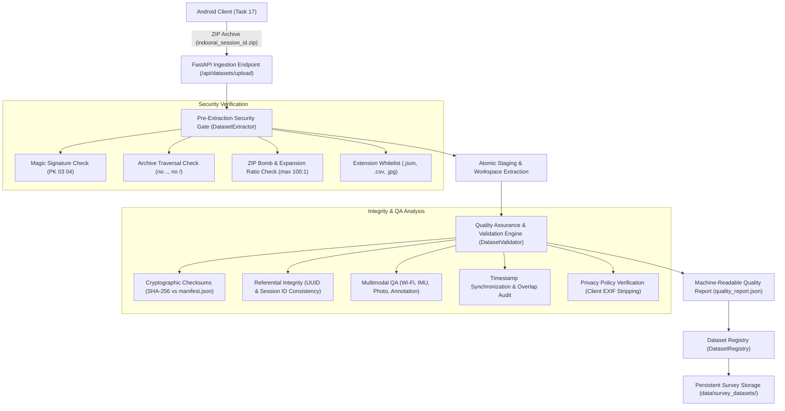

# IndoorAI — Multimodal Dataset Ingestion & Quality Assurance Backend Architecture

## 1. Executive Architectural Overview

The **Dataset Ingestion & Quality Assurance Backend** (Task 18) provides a secure, cryptographically verified, and mathematically audited pipeline for receiving, validating, analyzing, and cataloging multimodal survey sessions exported by authorized mobile handsets running the IndoorAI Android client (Task 17).



The system strictly enforces defense-in-depth: untrusted uploaded archives are inspected before extraction, decompression ratios and path climbs are blocked, and cryptographic SHA-256 digests are verified against the client manifest.

---

## 2. ZIP Archive Schema & File Layout

Compliant archives produced by `DatasetExporter` follow this exact internal structure:

```
indoorai_session_<session_id>.zip
├── session.json               # Top-level session parameters, lifecycle state, clock anchor
├── wifi_observations.csv      # Wi-Fi access point observations per sweep
├── imu_observations.csv       # High-frequency tri-axial accelerometer, gyro, magnetometer
├── photo_metadata.csv         # Visual landmark metadata, dimensions, sanitization status
├── annotations.csv            # Surveyor ground-truth notes and architectural event tags
├── manifest.json              # File inventory, record counts, and SHA-256 digests
└── images/                    # Directory of privacy-sanitized JPEG/PNG landmark photos
    ├── photo_001.jpg
    └── photo_002.jpg
```

### 2.1 File Schemas & Headers

#### `session.json`
```json
{
  "sessionId": "SES-XXXXXXXX",
  "sessionName": "Survey Session",
  "createdAtMs": 1731855600000,
  "startTimeMs": 1731855600000,
  "endTimeMs": 1731855660000,
  "status": "COMPLETED",
  "buildingId": "BLDG-01",
  "floorId": "FL-02",
  "roomId": "ROOM-201",
  "clockAnchor": {
    "wallClockEpochMs": 1731855600000,
    "bootTimeNs": 123456789000,
    "anchorIsoUtc": "2026-11-17T15:00:00.000Z"
  },
  "wifiCount": 12,
  "sensorCount": 1500,
  "photoCount": 4,
  "annotationCount": 2,
  "realObservationCount": 1518,
  "mockObservationCount": 0,
  "isInterrupted": false,
  "interruptionNote": null
}
```

#### `wifi_observations.csv`
```csv
observation_id,session_id,original_timestamp,time_source,normalized_epoch_ms,normalized_iso,sync_method,uncertainty_ms,is_fresh,is_mock,bssid,ssid,rssi_dbm,frequency_mhz,channel,channel_band,building,floor,room
```

#### `imu_observations.csv`
```csv
observation_id,session_id,original_timestamp_ns,time_source,normalized_epoch_ms,normalized_iso,sync_method,uncertainty_ms,sensor_type,x,y,z,magnitude,accuracy,sampling_rate,is_mock
```

#### `photo_metadata.csv`
```csv
photo_id,session_id,original_timestamp,time_source,normalized_epoch_ms,normalized_iso,sync_method,uncertainty_ms,filename,file_path,file_size_bytes,image_width,image_height,building,floor,room,landmark_type_code,landmark_type_name,description,notes,is_exif_sanitized,faces_detected_count,face_blur_applied,face_detection_status,is_mock
```

#### `annotations.csv`
```csv
annotation_id,session_id,original_timestamp,time_source,normalized_epoch_ms,normalized_iso,sync_method,uncertainty_ms,type_code,type_name,description,building,floor,room,related_observation_id,is_mock
```

#### `manifest.json`
```json
{
  "exportVersion": "1.0.0",
  "sessionId": "SES-XXXXXXXX",
  "exportedAtMs": 1731855665000,
  "exportedAtIso": "2026-11-17T15:01:05.000Z",
  "recordCounts": {
    "wifiCount": 12,
    "imuCount": 1500,
    "photoCount": 4,
    "annotationCount": 2,
    "totalObservations": 1518
  },
  "sourceCounts": {
    "realObservationCount": 1518,
    "mockObservationCount": 0,
    "containsRealData": true,
    "containsMockData": false
  },
  "files": [
    {
      "filename": "session.json",
      "sizeBytes": 612,
      "sha256": "e3b0c44298fc1c149afbf4c8996fb92427ae41e4649b934ca495991b7852b855"
    }
  ],
  "validationStatus": "VALIDATED"
}
```

---

## 3. Defense-in-Depth ZIP Security Pipeline

Uploaded archives are treated as untrusted inputs. Security validation is enforced in `DatasetExtractor`:

1. **ZIP Magic Signature Validation:** Ensures the upload is a legitimate archive by asserting leading bytes match standard signatures (`PK\x03\x04`, `PK\x05\x06`, or `PK\x07\x08`).
2. **Path Traversal & Symlink Defense:**
   - Every archive entry path is inspected before writing.
   - Prohibits absolute paths (`/etc/passwd`, `C:\evil`).
   - Prohibits directory traversal climbs (`..`).
   - Prohibits symbolic links (`stat.S_ISLNK`).
   - Verifies extracted target resolves inside the destination workspace (`path.is_relative_to(dest_dir)`).
3. **ZIP Bomb & Resource Exhaustion Defense:**
   - Rejects archives exceeding `MAX_ARCHIVE_ENTRIES` (10,000 entries).
   - Rejects entries with compression ratios exceeding `MAX_COMPRESSION_RATIO` (100:1).
   - Enforces `MAX_UPLOAD_SIZE_BYTES` (500 MB) and `MAX_EXTRACTED_SIZE_BYTES` (2 GB).
   - Streams files in 64 KB buffers, tracking actual written bytes to prevent decompression inflation exploits.
4. **Extension Whitelisting:**
   - Only approved extensions are allowed: `.json`, `.csv`, `.jpg`, `.jpeg`, `.png`.
   - Executable binaries, scripts (`.sh`, `.exe`, `.py`), and unknown extensions are strictly rejected.
5. **Duplicate Entry Detection:** Rejects archives containing duplicated paths to prevent file-overwrite ambiguity attacks.
6. **Atomic Cleanup on Failure:** If any security check or decompression step fails, the destination workspace is wiped via `shutil.rmtree()`, leaving no orphaned artifacts.

---

## 4. Cryptographic Manifest & Schema Validation

Validation is performed by `DatasetValidator`:

- **Cryptographic Hash Matching:** Computes SHA-256 digests of all extracted files and verifies exact equality against `manifest.json`. Any bit alteration results in `CORRUPTED` status.
- **Record Count Verification:**
  - Wi-Fi: Counts distinct `observation_id`s across rows to account for multiple APs per sweep.
  - Sensors, Photos, Annotations: Verifies row counts against `manifest.recordCounts`.
- **Referential Consistency:**
  - Every observation row in every CSV must cite `session_id == session.json.sessionId`.
  - Observation IDs must follow UUID / standard prefix conventions (`WIFI-`, `IMU-`, `IMG-`, `ANN-`).
- **Privacy Policy Verification:**
  - Every record in `photo_metadata.csv` must declare `is_exif_sanitized == true`.
  - Any photo missing client-side sanitization triggers a fatal validation failure.
  - Image files referenced in metadata must exist on disk with valid image headers.
- **Empty Modalities Supported:** Sessions legitimately lacking specific modalities (e.g., Wi-Fi-only surveys) are fully valid provided CSV headers are intact.

---

## 5. Multimodal Data Quality Assurance

The analyzer calculates statistical and domain-specific quality metrics:

### 5.1 Wi-Fi Stream Quality
- Sweep and AP counts, unique BSSID coverage.
- Mean visible APs per scan sweep (warnings surfaced if density $< 2.0$ APs/scan).
- Min/Max RSSI (validates signal levels fall within standard $-115 \text{ dBm} \le \text{RSSI} \le 0 \text{ dBm}$).
- Fresh versus cached scan counts and duplicate BSSID detection within sweeps.

### 5.2 Sensor Stream Quality
- Per-sensor counts (`ACCELEROMETER`, `GYROSCOPE`, `MAGNETIC_FIELD`, `ROTATION_VECTOR`).
- Mean sampling frequency ($Hz$) and interval metrics computed per sensor stream:
  $$f_{\text{sample}} = \frac{1000}{\overline{\Delta t_{\text{ms}}}}$$
- Detection of sensor dropouts and sampling gaps ($\Delta t > 5 \times \overline{\Delta t}$).
- Floating-point validity checks (NaN, Inf, or missing tri-axial coordinates).

### 5.3 Photo Quality & Visual Privacy Distinction
- Verified image files on disk, detected formats (JPEG, PNG).
- Face detection counts and face-blur application flags.
- Duplicate image content hash detection.
- **Critical Architectural Invariant:** The report strictly distinguishes between:
  - `metadata_sanitization_verified`: Client reported EXIF stripping (verified via metadata).
  - `visual_privacy_audited`: Independent visual privacy model execution (marked `PENDING_AUDIT` or `NOT_PERFORMED` to prevent false security claims).

### 5.4 Annotation Quality
- Breakdown by type (`CORRIDOR`, `DOOR`, `ROOM_ENTRANCE`, `STAIRCASE`, `ELEVATOR`, `LANDMARK`, `REFERENCE_POINT`, `LOCATION_CORRECTION`, `NOTE`).
- Missing description and labeling completeness metrics.

---

## 6. Timestamp Quality & Cross-Modal Temporal Overlap

Reconciles mobile clock domains:

- Evaluates `time_source` domains (`CLOCK_BOOTTIME_NANOS`, `CLOCK_BOOTTIME_MICROS`, `CLOCK_REALTIME_MILLIS`).
- Documents producer synchronization methods (`BOOTTIME_OFFSET`, `DIRECT_REALTIME`).
- Analyzes reported uncertainty bounds, explicitly labeling provenance as `producer_reported`.
- Checks stream monotonicity (flags out-of-order timestamps and large telemetry gaps).
- **Cross-Modal Temporal Overlap:**
  Calculates pairwise intersection intervals between active sensor streams:
  $$\text{overlap}(A, B) = \max\left(0, \frac{\min(T_{\text{end}}^A, T_{\text{end}}^B) - \max(T_{\text{start}}^A, T_{\text{start}}^B)}{1000}\right) \text{ seconds}$$
  Computes concurrent overlap across all modalities and produces a concise timeline summary.

---

## 7. Storage Layout & Dataset Registry

Persistent survey data is stored in `data/survey_datasets/` (excluded from version control via `.gitignore`):

```text
data/survey_datasets/
├── registry.json                    # Central thread-safe JSON index
├── raw_zips/                        # Preserved immutable original ZIP archives
│   ├── <dataset_id_1>.zip
│   └── <dataset_id_2>.zip
└── extracted/                       # Extracted dataset workspaces
    ├── <dataset_id_1>/
    │   ├── session.json
    │   ├── wifi_observations.csv
    │   ├── imu_observations.csv
    │   ├── photo_metadata.csv
    │   ├── annotations.csv
    │   ├── manifest.json
    │   ├── quality_report.json     # Saved machine-readable QA report
    │   └── images/
    │       └── photo_001.jpg
    └── <dataset_id_2>/
```

### 7.1 Registry Management (`DatasetRegistry`)
- Thread-safe in-memory cache backed by atomic writes (`registry.json.tmp` $\rightarrow$ `registry.json`).
- Stores high-level query summaries, observation counts, real/mock telemetry flags, and validation statuses.
- **Privacy Safety:** Internal disk paths are never exposed over public REST responses.

---

## 8. REST API Endpoints

FastAPI endpoints provided under `/api/datasets`:

| Method | Endpoint | Description | Status Code |
| :--- | :--- | :--- | :--- |
| `POST` | `/api/datasets/upload` | Upload and ingest a survey session ZIP archive | `201 Created` |
| `GET` | `/api/datasets` | List registered datasets with status/source filters | `200 OK` |
| `GET` | `/api/datasets/{dataset_id}` | Retrieve dataset details, counts, and metadata | `200 OK` |
| `GET` | `/api/datasets/{dataset_id}/quality` | Retrieve machine-readable data quality report | `200 OK` |
| `POST` | `/api/datasets/{dataset_id}/validate` | Re-run validation and quality checks on dataset | `200 OK` |
| `DELETE` | `/api/datasets/{dataset_id}` | Safely delete dataset and purge associated disk storage | `200 OK` |

Root metadata is available at `GET /` and container health probes at `GET /health`.

---

## 9. Known Limitations & Future Work

1. **Independent Visual Privacy Model:** Task 18 verifies client-reported EXIF sanitization metadata and image format headers. An independent server-side visual privacy model (detecting unblurred faces or readable documents) is planned for Phase 5.
2. **Live Localization:** Ingestion catalogs survey datasets for downstream ML training and sensor fusion; real-time localization inference is implemented in Tasks 21–25.
3. **Database Scalability:** The current registry uses an atomic local JSON index suitable for standalone deployments; PostgreSQL persistence with SQLAlchemy can be added in Task 27.
