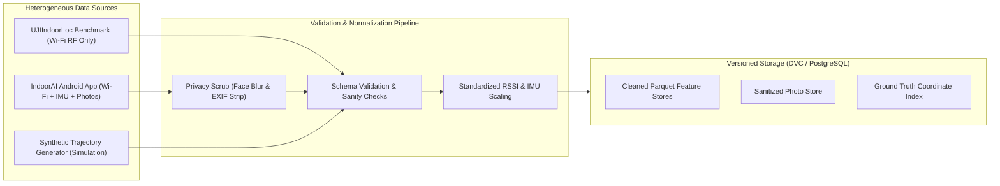

# IndoorAI — Data Strategy & Benchmark Specification

## 1. Primary Benchmark: UJIIndoorLoc Dataset

To establish rigorous, reproducible scientific baselines for the RF/Wi-Fi localization pipeline, IndoorAI adopts the **UJIIndoorLoc** dataset as its initial primary benchmark.

### 1.1 Dataset Summary & Attributes
Created by researchers at Universitat Jaume I (Castellón, Spain) in 2013, UJIIndoorLoc is the most widely cited open-source public benchmark for Wi-Fi fingerprinting.

| Property | Value / Specification |
| :--- | :--- |
| **Total Fingerprint Records** | 21,048 samples (19,937 training records, 1,111 validation records) |
| **Total Coverage Area** | ~108,703 $\text{m}^2$ across 3 multi-floor university campus buildings |
| **Number of Floors** | 4 to 5 floors per building (indexed 0 to 4) |
| **Number of Wi-Fi WAPs** | 520 distinct Wireless Access Points (`WAP001` through `WAP520`) |
| **Measurement Device Diversity**| 25 unique Android devices / models |
| **User Diversity** | 18 independent users (capturing distinct human body shadowing effects) |

### 1.2 Feature Schema Breakdown
The raw dataset comprises 529 columns:
1. **Wi-Fi Signal Levels (`WAP001` – `WAP520`):**
   - Discrete RSSI values measured in dBm (ranging from $-104\text{ dBm}$ to $0\text{ dBm}$).
   - **Crucial Sentinel Value:** The raw dataset encodes unobserved or out-of-range access points as `+100`. In the IndoorAI preprocessing pipeline, this must be mapped to an IEEE 802.11 signal floor (typically $-104\text{ dBm}$ or normalized to $0.0$) rather than treated as a positive signal strength.
2. **Spatial Ground Truth Labels:**
   - `BuildingID`: Categorical integer identifier $\{0, 1, 2\}$.
   - `Floor`: Categorical/ordinal integer identifier $\{0, 1, 2, 3, 4\}$.
   - `Longitude`: WGS84 metric continuous coordinate.
   - `Latitude`: WGS84 metric continuous coordinate.
   - `SpaceID`: Identification number for specific offices, labs, or corridor segments.
   - `RelativePosition`: Position relative to the space (Inside = 1, Outside doorway = 2).
3. **Contextual & Hardware Metadata:**
   - `UserID`: Identifier of the person capturing the fingerprint.
   - `PhoneID`: Hardware device identifier.
   - `Timestamp`: UNIX epoch integer representing time of collection.

### 1.3 What UJIIndoorLoc Can Train
- **Building Classification:** High-confidence multi-class classification separating Buildings 0, 1, and 2 (typical accuracy exceeds 99%).
- **Floor Classification:** Classification of the vertical floor level within the predicted building (typical baseline accuracy ranges between 88% and 94%).
- **2D Coordinate Regression:** Continuous mapping from 520-dimensional RSSI vectors to $(x, y)$ planar coordinates (evaluated via Mean Euclidean Error).
- **Device Heterogeneity Analysis:** Training on subsets of `PhoneID` and testing on unseen `PhoneID` values to measure cross-device generalization.

### 1.4 Known Limitations of UJIIndoorLoc
1. **Absence of Multimodal Streams:** UJIIndoorLoc **does not contain any photographs, camera images, or high-frequency smartphone sensor sequences (accelerometer, gyroscope, magnetometer)**. It is exclusively an RF fingerprinting dataset.
2. **Static Snapshot Sampling:** Fingerprints represent discrete static measurement points rather than continuous pedestrian walk trajectories, precluding direct testing of continuous dead reckoning (PDR) or velocity-based Kalman filtering.
3. **Temporal Drift:** Captured within a specific multi-month temporal window in 2013; does not capture long-term access point hardware upgrades or seasonal RF fluctuations.
4. **Sparsity:** Any single sample typically detects only 5 to 25 of the 520 access points, meaning > 95% of the input matrix consists of missing values.

---

## 2. Multimodal Data Strategy & Collection Framework

Because UJIIndoorLoc is exclusively an RF dataset, achieving the complete vision of IndoorAI requires a unified data strategy that introduces synchronized inertial and visual modalities.



### 2.1 Android Multi-Sensor Logging Protocol
To collect authentic multimodal datasets, the IndoorAI Android application implements a synchronized logging schema:

```json
{
  "session_id": "9b1deb4d-3b7d-4bad-9bdd-2b0d7b3dcb6d",
  "device_id_hash": "a8f3b2...",
  "timestamp_ms": 1700000000000,
  "wifi_fingerprint": [
    { "bssid": "00:14:22:01:23:45", "rssi": -65, "frequency_mhz": 2412, "ssid": "Campus-Secure" },
    { "bssid": "00:14:22:01:23:46", "rssi": -78, "frequency_mhz": 5180, "ssid": "Campus-Secure" }
  ],
  "imu_stream": {
    "rate_hz": 50,
    "accelerometer": [[0.01, 9.81, 0.15], [0.03, 9.79, 0.18]],
    "gyroscope": [[0.001, -0.002, 0.004]],
    "magnetometer": [[18.2, -5.1, 42.0]]
  },
  "user_photo": {
    "photo_id": "img_0042.jpg",
    "captured_timestamp_ms": 1700000000000,
    "user_heading_deg": 142.5,
    "exif_stripped": true
  },
  "ground_truth_label": {
    "building_id": "BUILDING_B",
    "floor": 2,
    "x_meters": 34.2,
    "y_meters": 12.8,
    "survey_method": "qr_anchor_scan"
  }
}
```

### 2.2 Ground Truth Collection Strategy
To prevent fabricated ground truth coordinates during real-world data collection campaigns:
- **Optical Anchor Checkpoints:** Pre-surveyed physical QR codes / ArUco markers posted at known metric positions $(x, y, z)$ on walls. The collection app scans the anchor to register absolute ground-truth reference points without human measurement error.
- **Topological Node Surveying:** Distinct architectural junctions (intersections of corridors, stairwell entrances) are mapped once using laser rangefinders or verified architectural blueprints.

### 2.3 Synthetic Trajectory Generation
To benchmark the sensor fusion algorithms (EKF and Particle Filter) prior to field campaigns:
- Kinematic pedestrian trajectory simulators generate continuous walks with simulated step dynamics, heading noise, magnetic anomalies, and synthetic Wi-Fi RSSI attenuation models based on 3D wall-path loss formulas ($PL(d) = PL_0 + 10 n \log_{10}(d) + WAF$).

---

## 3. Data Governance & Lifecycle Pipeline

1. **Immutability of Raw Data:** Raw downloads (e.g., UJIIndoorLoc raw CSV) and collected mobile sensor logs are stored in `data/raw/` in read-only form.
2. **Reproducible Pipelines:** All transformation scripts in `src/preprocessing/` must execute deterministically, emitting standardized Parquet files into `data/processed/`.
3. **Data Quality Assertions:**
   - Assert all RSSI readings fall within valid physical bounds ($-104\text{ dBm} \le \text{RSSI} \le 0\text{ dBm}$).
   - Assert IMU timestamps are strictly monotonically increasing with no duplicate packets.
   - Assert ground truth coordinates map within the physical bounding polygon of the designated building and floor.
4. **No Synthetic Claims:** Research reporting must strictly distinguish between results achieved on public benchmark datasets (UJIIndoorLoc) versus multimodal experimental captures.

