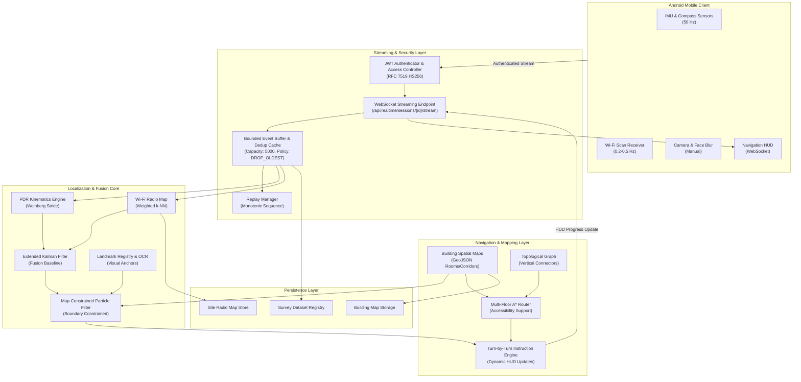
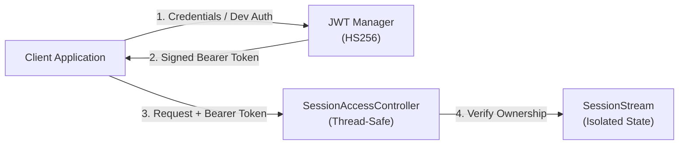

# IndoorAI — Final System Architecture Specification

**Version**: 1.0.0 (Release Ready)  
**System Status**: All 30 Tasks Integrated  
**Target Platform**: FastAPI Backend / Kotlin Android Client / Streamlit Dashboard  

---

## 1. High-Level Architectural Topology

IndoorAI is an end-to-end platform for indoor localization, spatial mapping, and turn-by-turn navigation in complex multi-floor structures where GPS signals are degraded or unavailable.

The architecture is composed of six primary layers:
1. **Client Capture Layer**: Authorized Android mobile application performing background Wi-Fi scanning, high-frequency IMU/magnetometer logging, manual camera capture with on-device face blurring, and live navigation HUD display.
2. **Real-Time Streaming & Ingestion Layer**: Asynchronous WebSocket and REST endpoints enforcing RFC 7519 HMAC-SHA256 JWT security, bounded-buffer backpressure (`DROP_OLDEST`), event deduplication, and replay managers.
3. **Core Processing & Sensor Fusion Engines**:
   - *Pedestrian Dead Reckoning (PDR)*: Peak detection, Weinberg stride estimation, and complementary orientation filtering.
   - *Site-Specific Wi-Fi Fingerprinting*: Weighted k-NN and Gaussian probabilistic radio-map localizers.
   - *Extended Kalman Filter (EKF)*: Continuous kinematic state propagation combined with absolute Wi-Fi measurement updates.
   - *Computer Vision Landmark Registry*: Visual landmark identification, door/staircase classification, and OCR room sign recognition.
   - *Map-Constrained Particle Filter (PF)*: Sequential Monte Carlo estimator constraining trajectories within verified architectural boundaries.
4. **Spatial Mapping & Topology Layer**: GeoJSON indoor building geometry, walkable polygon grids, topological navigation graphs, and vertical transition connectors (stairs, elevators, ramps).
5. **Intelligent Navigation & Guidance Layer**: Multi-floor Dijkstra and A* pathfinding, real-time off-route deviation detection, automatic rerouting, and turn-by-turn instruction generation.
6. **Presentation Layer**: Interactive Streamlit dashboard and mobile HUD for trajectory replay, spatial map inspection, and system telemetry.



---

## 2. End-to-End Data Flow

### 2.1 Real-Time Multimodal Ingestion Pipeline
1. **Device Ingestion**: Android client batches IMU samples (accelerometer, gyroscope, orientation) or Wi-Fi scan results with local timestamps and client monotonic sequence numbers.
2. **Authentication Handshake**: Connection opens via WebSocket query `?token=<JWT>`. `authenticate_websocket_connection` verifies cryptographic signature and ensures token is unexpired.
3. **Session Access Check**: `SessionAccessController` checks if `claims.sub` owns the requested `session_id` or possesses `ADMIN` privileges.
4. **Idempotency & Deduplication**: The event enters `SessionStream`. If `event_id` exists in the bounded 10,000-entry deduplication set, an idempotent `DUPLICATE` ACK is returned immediately.
5. **Payload Validation**: `EventValidator` checks schema compliance, valid Wi-Fi RSSI ranges $[-120, 0]$ dBm, sample sizes, and non-negative timestamps.
6. **Buffer & Backpressure**: Valid events are enqueued in `BoundedEventBuffer`. If capacity exceeds limit, the oldest event is evicted and logged.
7. **Downstream Dispatch**:
   - Wi-Fi scans trigger radio map fingerprint matching.
   - IMU samples trigger step detection and heading integration.
   - PDR steps update the `MapConstrainedParticleFilter`. Wall collisions reject physically impossible particles.
   - If attached, the resulting filtered state $(x, y, \text{floor})$ advances the active `NavigationSession`.
8. **Acknowledgement & Replay**: The server returns an `ACCEPTED` ACK with server receive timestamp and monotonic sequence number. Replayed items are cached for fast reconnection recovery.

---

## 3. Cryptographic Security & Multi-Tenant Model



- **Algorithm**: RFC 7519 HMAC-SHA256 with 256-bit secret key.
- **Payload Claims**:
  - `sub`: Unique persistent user ID.
  - `role`: Role enum (`ADMIN`, `SURVEYOR`, `NAVIGATOR`, `VIEWER`).
  - `allowed_sessions`: List of allowed session IDs or `["*"]` for global access.
  - `device_id`: Pseudonymous device identifier.
  - `exp`: Absolute expiration epoch timestamp.
- **Constant-Time Verification**: Verification uses `hmac.compare_digest` to prevent side-channel timing attacks.

---

## 4. Algorithmic Localization & Fusion Pipeline

### 4.1 Extended Kalman Filter (Sensor Fusion)
Combines continuous high-frequency relative motion from PDR with intermittent absolute position estimates from Wi-Fi:
- **State Vector**:
  $$\mathbf{x} = [x, y, \theta, b_x, b_y]^T$$
- **Process Model**:
  $$\begin{bmatrix} x_k \\ y_k \end{bmatrix} = \begin{bmatrix} x_{k-1} \\ y_{k-1} \end{bmatrix} + L_k \begin{bmatrix} \cos(\theta_{k-1} + \Delta\theta_k) \\ \sin(\theta_{k-1} + \Delta\theta_k) \end{bmatrix}$$
- **Measurement Model**: Wi-Fi fixes update state position $(x, y)$ using measurement covariance $\mathbf{R}_{\text{wifi}}$.

### 4.2 Map-Constrained Particle Filter
Sequential Monte Carlo filter enforcing physical architectural constraints:
- **State Representation**: $N=500$ particles $\mathbf{p}_i = (x_i, y_i, \theta_i, \text{floor}_i, w_i)$.
- **Motion Update**: Displaced by detected step length $L$ and heading $\theta$ with Gaussian perturbation noise.
- **Wall Non-Crossing Constraint**: Line segment between $\mathbf{p}_i^{(t-1)}$ and $\mathbf{p}_i^{(t)}$ is tested against all building wall geometries using Shapely spatial predicates. Particles intersecting non-doorway walls have their weights set to 0.
- **Measurement Likelihood**: Updated using Wi-Fi radio map likelihood and visual landmark proximity models.
- **Resampling**: Systematic resampling triggered when $N_{\text{eff}} < \frac{N}{2}$.

---

## 5. Indoor Navigation & Intelligent Route Guidance

- **Graph Topology**: Buildings are represented as directed graphs where nodes represent rooms, corridor intersections, and vertical transitions (stairs, elevators).
- **Search Algorithms**:
  - **Dijkstra**: Guaranteed shortest path for standard queries.
  - **A\***: Heuristic Euclidean distance search for rapid interactive routing.
- **Rerouting Engine**: Monitors cross-track error $d_{\perp}$. If user deviates $> 4.0\text{ m}$ from planned route for $> 3$ consecutive steps, automatic recalculation is initiated without resetting target destination.
- **Turn-by-Turn Instruction Generator**: Classifies angular heading deltas into natural instructions (`CONTINUE_STRAIGHT`, `TURN_LEFT`, `TURN_RIGHT`, `TAKE_STAIRS`, `USE_ELEVATOR`).

---

## 6. Directory Structure & Key Modules

```
IndoorAI/
├── android/                        # Android Client Application
│   └── app/src/main/java/...       # Wi-Fi, IMU, Camera, HUD implementations
├── backend/app/                    # FastAPI Backend Application
│   ├── api/routes/                 # REST & WebSocket API endpoints
│   ├── core/                       # Configuration, logging, JWT security
│   ├── schemas/                    # Pydantic serialization schemas
│   └── services/                   # Real-time pipeline, navigation services
├── src/                            # Core Algorithmic Subsystems
│   ├── core/                       # Utilities and base definitions
│   ├── data/                       # Ingestion and survey session management
│   ├── eda/                        # Exploratory data analysis
│   ├── preprocessing/              # UJI & multimodal temporal preprocessing
│   ├── features/                   # Wi-Fi signal feature extraction & selection
│   ├── models/                     # k-NN, Random Forest, MLP, Hybrid localizers
│   ├── pdr/                        # Pedestrian Dead Reckoning & calibration
│   ├── wifi_localization/          # Site-specific radio maps & fingerprinting
│   ├── sensor_fusion/              # EKF engine & multimodal pipeline
│   ├── computer_vision/            # Landmark detection & OCR engine
│   ├── mapping/                    # Spatial geometry, polygons, topology graph
│   ├── map_localization/           # Map-constrained Particle Filter
│   ├── navigation/                 # A* pathfinding, rerouting, HUD guidance
│   └── evaluation/                 # Benchmark harnesses & error analysis
├── tests/                          # 323 passing automated tests
└── docs/                           # Architectural, audit, and setup documentation
```
