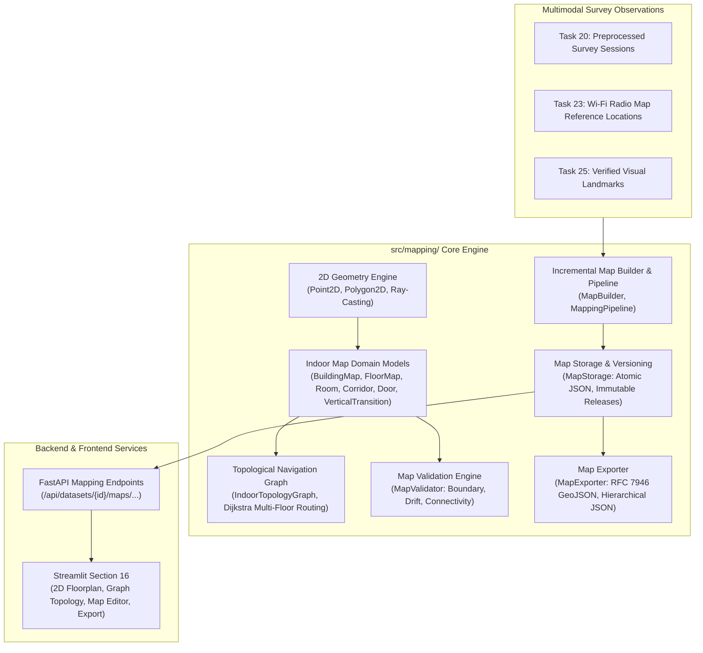

# Indoor Map Generation & Spatial Representation Architecture (Task 26)

## 1. Overview & Architectural Purpose

Task 26 introduces the indoor spatial representation and map generation subsystem for **IndoorAI**.

The subsystem transforms manually surveyed building information, verified visual landmarks (Task 25), Wi-Fi reference locations (Task 23), and multimodal spatial observations into a structured, topologically connected, and mathematically validated indoor map.



---

## 2. Spatial Entities & Domain Data Models

All indoor spatial entities are defined under `src/mapping/models.py` and coordinate primitives under `src/mapping/geometry.py`:

| Domain Entity | Schema Type | Description & Attributes |
| :--- | :--- | :--- |
| **`Point2D`** | Geometric Primitive | Metric coordinate pair `(x, y)` in local East-North Cartesian frame. |
| **`Polygon2D`** | Geometric Primitive | Ordered vertices, Shoelace metric area, centroid, ray-casting containment, self-intersection checks. |
| **`Room`** | Spatial Polygon | Enclosed room polygon, `RoomCategory` (OFFICE, LAB, CLASSROOM, etc.), area, door references, verification status. |
| **`Corridor`** | Navigable Centerline | Navigable centerline trajectory waypoints, width, length, connected room IDs, door links. |
| **`Door`** | Traversal Waypoint | Door coordinates, `DoorType` (SINGLE_SWING, SLIDING, etc.), `connects_from_id`, `connects_to_id`, emergency exit flag. |
| **`VerticalTransition`** | Multi-Floor Link | Staircase or elevator shaft with landings on multiple floors, wheelchair accessibility flag. |
| **`SpatialConnection`** | Topological Edge | Edge connecting two spatial entities, 3D metric distance, accessibility classification. |
| **`FloorMap`** | Single Level | Floor boundary, elevation, rooms, corridors, doors, Wi-Fi reference points, visual landmarks. |
| **`BuildingMap`** | Root Hierarchy | Multi-floor building model, coordinate frame metadata (`BUILDING_LOCAL_CARTESIAN_ENU`), version string, provenance. |

---

## 3. Coordinate System & Anti-Fabrication Principles

### 3.1 Standard Metric Coordinate Frame
- **Frame ID:** `BUILDING_LOCAL_CARTESIAN_ENU`
- **Units:** Metric (`meters`)
- **Axis Conventions:** $+X$ points East along the building facade; $+Y$ points North orthogonal to $+X$; $+Z$ points upward (elevation in meters).
- **Zero Fabrication:** The system strictly refuses to fabricate or interpolate floorplans from incomplete observations. Areas without ground-truth survey annotations are explicitly marked with `MapVerificationStatus.UNVERIFIED` or `PARTIALLY_SURVEYED`.

---

## 4. Topological Navigation Graph Construction

The topological navigation graph (`src/mapping/topology.py`) models spatial connectivity:

1. **Room Nodes:** Centroids of rooms (`TopologyNodeType.ROOM_CENTROID`).
2. **Corridor Nodes:** Waypoints and intersections along corridor centerlines (`CORRIDOR_WAYPOINT`, `CORRIDOR_INTERSECTION`).
3. **Door Nodes:** Door portals (`DOORWAY`, `BUILDING_EXIT`).
4. **Vertical Landing Nodes:** Multi-floor landings for stairwells and elevator shafts (`STAIR_LANDING`, `ELEVATOR_LANDING`).
5. **Connectivity & Routing:**
   - Doors connect rooms to corridors with bidirectional traversal edges.
   - Staircases connect floor landings with `AccessibilityType.STAIRS_ONLY`.
   - Elevators connect floor landings with `AccessibilityType.WHEELCHAIR_ACCESSIBLE`.
   - Graph evaluation supports Breadth-First Search (BFS) connected components, isolated node detection, and Dijkstra shortest path routing across multiple floors with wheelchair accessibility filtering.

---

## 5. Map Validation Engine

`MapValidator` (`src/mapping/map_validator.py`) audits maps across 5 distinct stages:

1. **Coordinate Frame Check:** Enforces `BUILDING_LOCAL_CARTESIAN_ENU` and meter units.
2. **Floor Level Integrity:** Validates boundary closure, non-zero area, and checks that room centroids lie within floor boundaries.
3. **Geometric Sanity:** Detects self-intersecting polygon boundaries (bowtie/hourglass errors) and corridor centerline lengths $< 0.5\text{m}$.
4. **Referential Integrity:** Verifies that doors connect existing rooms or corridors, and checks that vertical transitions reference valid floors.
5. **Vertical Planar Alignment:** Flags vertical transitions whose horizontal planar displacement across floors exceeds $8.0\text{m}$ (`VERTICAL_TRANSITION_MISALIGNMENT`).
6. **Topological Reachability:** Identifies isolated topological nodes with 0 connections and disconnected floor subgraphs.

---

## 6. Atomic Storage & Versioning Architecture

`MapStorage` (`src/mapping/map_storage.py`) manages filesystem persistence under `data/indoor_maps/{building_id}/`:

```
data/indoor_maps/{building_id}/
├── building.json                 # Root building metadata, version, and vertical transitions
├── connections.json              # Topological navigation connections
├── floors/
│   ├── floor_0.json              # Floor 0 boundary, rooms, corridors, doors, wifi refs, landmarks
│   └── floor_1.json              # Floor 1 boundary, rooms, corridors, doors, wifi refs, landmarks
└── versions/
    ├── v1.0.0/
    │   └── map_snapshot.json     # Immutable frozen release snapshot of version 1.0.0
    └── v1.1.0/
        └── map_snapshot.json     # Immutable frozen release snapshot of version 1.1.0
```

- **Atomic Writes:** Saves updates into temporary staging folders (`{building_id}_tmp_...`) before atomic rename, preventing file corruption on process interruption.
- **Snapshot Immutability:** Version snapshots are frozen in historical numbered directories and cannot be overwritten.

---

## 7. Standards-Compliant Export Formats

`MapExporter` (`src/mapping/map_export.py`) serializes maps into two standard formats:

1. **RFC 7946 GeoJSON FeatureCollection:**
   - Room polygons (`Polygon`)
   - Corridor centerlines (`LineString`) and boundaries (`Polygon`)
   - Doors (`Point`)
   - Vertical transitions (`Point`)
   - Wi-Fi reference locations (`Point`)
   - Visual landmarks (`Point`)
   - Topological navigation edges (`LineString`)
2. **Hierarchical JSON:**
   - Full domain schema representation of `BuildingMap` or single `FloorMap`.

---

## 8. REST API Endpoints

The mapping service exposes REST endpoints under `/api/datasets/{dataset_id}/maps/`:

- `GET /api/datasets/{dataset_id}/maps/buildings` — List all building map summaries.
- `GET /api/datasets/{dataset_id}/maps/{building_id}` — Retrieve full building map hierarchy.
- `POST /api/datasets/{dataset_id}/maps/buildings` — Create or update building map root.
- `POST /api/datasets/{dataset_id}/maps/floors` — Add floor level.
- `POST /api/datasets/{dataset_id}/maps/rooms` — Add room polygon.
- `POST /api/datasets/{dataset_id}/maps/corridors` — Add corridor centerline.
- `POST /api/datasets/{dataset_id}/maps/doors` — Add door portal.
- `POST /api/datasets/{dataset_id}/maps/vertical-transitions` — Add staircase or elevator.
- `POST /api/datasets/{dataset_id}/maps/connections` — Add topological edge.
- `POST /api/datasets/{dataset_id}/maps/{building_id}/import-wifi` — Import Wi-Fi reference points.
- `POST /api/datasets/{dataset_id}/maps/{building_id}/import-landmarks` — Import visual landmarks.
- `POST /api/datasets/{dataset_id}/maps/{building_id}/validate` — Run geometric and topological validation.
- `POST /api/datasets/{dataset_id}/maps/{building_id}/evaluate` — Compute spatial coverage and graph metrics.
- `POST /api/datasets/{dataset_id}/maps/{building_id}/publish` — Publish immutable version release.
- `GET /api/datasets/{dataset_id}/maps/{building_id}/versions` — List version release history.
- `GET /api/datasets/{dataset_id}/maps/{building_id}/export/{format}` — Export GeoJSON or JSON.

---

## 9. Streamlit Dashboard (Section 16)

The Streamlit UI in `frontend/components/mapping_view.py` provides 4 interactive tabs:

1. **2D Floorplan & Spatial Geometry:** Interactive Plotly visual canvas displaying rooms colored by category, corridor trajectories, doors, vertical transition markers, Wi-Fi reference locations, and visual landmarks with layer visibility controls.
2. **Topological Navigation Graph:** 2D interactive node-link graph visualization displaying room centroids, corridors, doors, and transitions colored by node type and edge accessibility.
3. **Map Editor & Multimodal Ingestion:** Forms to add floors, rooms, and doors, plus bulk import utilities for Task 23 Wi-Fi reference points and Task 25 visual landmarks.
4. **Validation, Evaluation & Export:** One-click validation audit, version publishing with tags, and GeoJSON/JSON download buttons.
