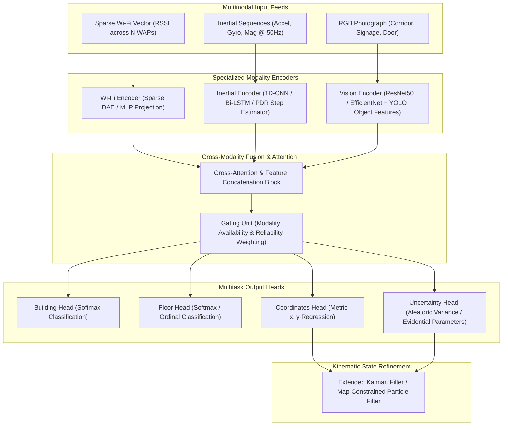

# IndoorAI — Machine Learning Architecture

## 1. Overview and Design Philosophy

Indoor localization presents distinct mathematical and physical challenges:
- High-dimensional, sparse, and fluctuating RF signal observations (Wi-Fi multipath, shadow fading, human body attenuation).
- Non-linear temporal drifts in low-cost smartphone inertial measurement units (accelerometer bias drift, gyroscope noise integration).
- Environmental dynamics, lighting variations, and perspective distortion in indoor photography.

To resolve these challenges robustly, the **IndoorAI** machine learning architecture is designed as a hierarchical, multi-stage system spanning traditional tabular baselines, deep neural networks, computer vision representations, kinematic state filters, and multimodal fusion with calibrated uncertainty.

---

## 2. Traditional Machine Learning Baselines

Before employing complex neural models, IndoorAI establishes strong, interpretable baselines using tabular machine learning algorithms.

### 2.1 Random Forest
- **Purpose:** Serve as a fast, robust baseline for hierarchical building and floor classification, and non-linear coordinate regression.
- **Why it is used:** Random Forests are naturally resilient to feature scale differences, handle unobserved Wi-Fi Access Points (imputed default signal levels) without divergence, and provide Gini-impurity-based feature importance to identify the most informative WAPs.
- **Target Formulations:**
  - Classifier 1: Building ID prediction ($\mathcal{C}_{\text{building}} \in \{0, 1, 2\}$).
  - Classifier 2: Floor ID prediction ($\mathcal{C}_{\text{floor}} \in \{0, 1, 2, 3, 4\}$ conditioned on Building).
  - Regressor: Independent or chained Multi-Output Regressors for $(x, y)$ coordinate estimation.

### 2.2 XGBoost (Extreme Gradient Boosting)
- **Purpose:** Provide state-of-the-art tabular accuracy on sparse Wi-Fi RSSI matrices.
- **Why it is used:** Gradient boosted decision trees optimize custom objective functions, support L1/L2 regularization to prevent overfitting on specific access points, and natively handle sparsity patterns where only a small subset of WAPs is visible in any single scan.

---

## 3. Deep Learning Architecture

### 3.1 Multitask Multi-Layer Perceptron (Multitask MLP)
Indoor positioning inherently couples discrete topological decisions (which building, which floor) with continuous spatial coordinates $(x, y)$. Training separate models loses shared representation benefits. The deep learning backbone uses a shared representation with task-specific projection heads.

- **Architecture Details:**
  - **Input Layer:** Normalized RSSI vector $\mathbf{r} \in \mathbb{R}^N$ ($N \approx 520$ for benchmarks, dynamic for real deployments).
  - **Shared Trunk:** 3 to 4 dense layers (e.g., $512 \to 256 \to 128$) with Batch Normalization, ReLU/GELU activations, and Dropout ($p = 0.3$) to prevent co-adaptation.
  - **Hierarchical Conditioning:** The building logits condition the floor representation, and the floor embedding conditions the coordinate regression head.
  - **Task Heads:**
    1. **Building Head:** Linear projection $\to$ Cross-Entropy Loss.
    2. **Floor Head:** Linear projection $\to$ Cross-Entropy / Ordinal Ranking Loss.
    3. **Coordinate Head:** Linear projection to continuous $(x, y)$ coordinates $\to$ Euclidean/Smooth L1 Loss.
  - **Multitask Loss Balancing:**
    $$\mathcal{L}_{\text{total}} = \lambda_{\text{bld}} \mathcal{L}_{\text{bld}} + \lambda_{\text{flr}} \mathcal{L}_{\text{flr}} + \lambda_{\text{coord}} \mathcal{L}_{\text{coord}}$$
    Weights are dynamically adapted during training using uncertainty-based multi-task loss weighting (Kendall et al.).

---

## 4. Computer Vision Modules

Vision provides absolute positional cues that drastically cut down spatial ambiguity (e.g., recognizing a specific room label "Room 402" or an architecturally distinct atrium).

### 4.1 Pretrained Deep Feature Extractors (ResNet / EfficientNet)
- **Purpose:** Map uploaded indoor photographs into compact visual embedding vectors $\mathbf{v} \in \mathbb{R}^d$ ($d = 512$ or $1280$).
- **Methodology:** Pretrained on ImageNet and fine-tuned using deep metric learning (Triplet Loss / Cosine Margin Loss) on indoor scene datasets (such as Places365 or IndoorCV benchmarks).
- **Inference Role:** When an image is received, its embedding is compared against a pre-indexed vector database (`pgvector`) of known location anchors via Cosine Similarity / k-Nearest Neighbors.

### 4.2 Object & Landmark Detection (YOLO)
- **Purpose:** Detect and locate semantic indoor objects, navigational signs, egress signs, door placards, and room identification numbers.
- **Model:** YOLOv8/YOLOv9 fine-tuned on indoor signage and structural elements.
- **Inference Role:** Extracted bounding boxes and class labels (e.g., `["fire_exit", "room_number_plate", "elevator_doors"]`) provide discrete spatial tokens that act as categorical topological anchors.

### 4.3 Semantic Image Segmentation
- **Purpose:** Identify walkable floor surfaces versus non-walkable obstacles (walls, furniture, structural pillars) from user images.
- **Model:** Lightweight SegFormer or MobileNetV3-DeepLabV3.
- **Inference Role:** Computes free-space visual bounds that refine the local metric map and validate that estimated device positions lie on walkable indoor ground planes.

---

## 5. Smartphone Sensor Processing & Kinematics

Smartphone sensors measure relative change in position and orientation at high temporal resolution (50 Hz), filling the gap between sparse Wi-Fi scans.

### 5.1 Inertial Processing & Pedestrian Dead Reckoning (PDR)
- **Step Detection:** Peak detection and dynamic thresholding on the normalized accelerometer magnitude signal $a_{\text{norm}}(t) = \sqrt{a_x^2 + a_y^2 + a_z^2} - g$.
- **Step Length Estimation:** Non-linear models (e.g., Weinberg equation: $L_{\text{step}} = K \cdot \sqrt[4]{a_{\text{max}} - a_{\text{min}}}$) calibrated per user walking pattern.
- **Heading Estimation:** Sensor fusion of angular velocity from the gyroscope with geomagnetic heading from the 3-axis magnetometer, filtered to cancel magnetic anomalies caused by structural steel beams.

### 5.2 Kinematic State Estimation: Kalman & Particle Filtering
- **Extended Kalman Filter (EKF):**
  - **State Vector:** $\mathbf{x}_k = [x_k, y_k, v_{x,k}, v_{y,k}, \theta_k]^T$.
  - **Predict Phase:** Propagates state using high-frequency PDR step vectors ($L_{\text{step}}, \theta$).
  - **Update Phase:** Updates state when an absolute Wi-Fi fingerprint fix or visual landmark match arrives, weighting by the measurement covariance.
- **Map-Constrained Particle Filter:**
  - Maintains $M$ particles representing hypothesized user locations.
  - Enforces hard architectural boundary constraints: particles whose trajectories cross structural walls or non-walkable zones are assigned zero likelihood and eliminated during importance resampling.

---

## 6. Multimodal Learning & Fusion Strategy

Real-world indoor environments are dynamic: Wi-Fi signals may be jammed or absent in basements; users may not take photos continuously; IMUs experience integration drift over extended walks. The multimodal fusion system must operate reliably with **missing or asynchronous modalities**.

### 6.1 Modality Encoders
1. **Wi-Fi Encoder:** Maps sparse RSSI inputs to a dense latent vector $\mathbf{z}_{\text{wifi}} \in \mathbb{R}^{128}$.
2. **Vision Encoder:** Maps image landmarks and scene embeddings to $\mathbf{z}_{\text{vision}} \in \mathbb{R}^{128}$.
3. **Sensor/PDR Encoder:** Maps recent temporal IMU trajectory slices to $\mathbf{z}_{\text{imu}} \in \mathbb{R}^{64}$.

### 6.2 Gated Fusion Mechanism
A self-attention gating unit computes an availability and confidence mask $\boldsymbol{\alpha} = [\alpha_{\text{wifi}}, \alpha_{\text{vision}}, \alpha_{\text{imu}}]$ where $\sum \alpha_i = 1$:
$$\mathbf{z}_{\text{fused}} = \alpha_{\text{wifi}} \mathbf{W}_w \mathbf{z}_{\text{wifi}} + \alpha_{\text{vision}} \mathbf{W}_v \mathbf{z}_{\text{vision}} + \alpha_{\text{imu}} \mathbf{W}_m \mathbf{z}_{\text{imu}}$$
If no image is uploaded during a tracking interval, $\alpha_{\text{vision}} \to 0$ and the network gracefully relies on the Wi-Fi + IMU representations.

### 6.3 Confidence and Uncertainty Estimation
- **Aleatoric Uncertainty:** Model heads output parameters of a predictive Gaussian distribution $(\mu_x, \sigma_x^2, \mu_y, \sigma_y^2, \rho)$, providing an explicit 2D covariance ellipse for the predicted coordinates.
- **Epistemic Uncertainty:** Estimated via Monte Carlo Dropout (evaluating variance over $T$ stochastic forward passes) or Deep Ensembles, alerting the system when a device encounters an unmapped or out-of-distribution indoor area.

