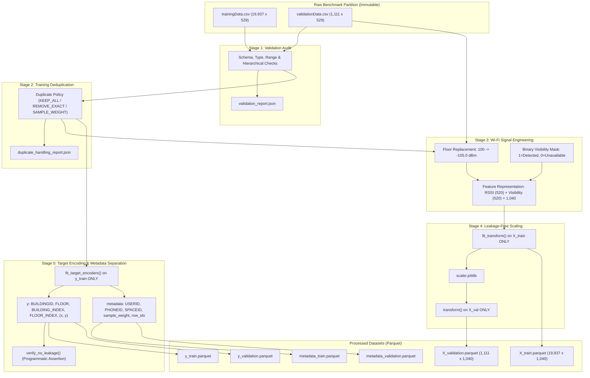

# IndoorAI — Data Validation & Preprocessing Pipeline

## 1. Architectural Overview & Design Philosophy

The **IndoorAI Preprocessing Pipeline** converts raw, heterogeneous indoor localization benchmark data (starting with UJIIndoorLoc) into normalized, machine-learning-ready feature and target tensors. It is engineered with strict adherence to three architectural invariants:

1. **Absolute Immutability of Raw Data:** Raw dataset partitions in `data/raw/ujiindoorloc/` are strictly read-only and preserved with cryptographic checksums.
2. **Zero Information Leakage:** Imputation baselines, feature selection, scaling parameters (e.g. min, max, mean, std), and categorical label mappings are fitted **exclusively on the training dataset**. Validation partitions are transformed strictly using fitted training parameters.
3. **Rigorous Separation of Concerns:** Features $X$, targets $y$, and contextual metadata are partitioned into distinct Parquet dataframes, guaranteeing that targets and metadata can never be accidentally included as model inputs.



---

## 2. Missing Wi-Fi Signal Representation & Signal Floor

In UJIIndoorLoc, access points out of radio range are encoded as integer **`+100`**.
- It is physically impossible for an 802.11 receiver to record $+100\text{ dBm}$ (genuine signals range between $-104\text{ dBm}$ and $0\text{ dBm}$).
- Treating `100` as a continuous RSSI measurement distorts Euclidean distance calculations, covariance matrices, and neural network gradients.

### Solution Implemented
1. **Physical Noise Floor Replacement:** All `100` occurrences are remapped to a configurable signal floor $\theta_{\text{floor}} = -105.0\text{ dBm}$, which is strictly below the lowest physically recorded valid measurement in the training dataset ($-104.0\text{ dBm}$).
2. **Signal Preservation:** Genuine measurements ($\le 0\text{ dBm}$) are strictly preserved in their original decibel-milliwatt values.

---

## 3. Explicit Access Point Visibility Masks

To provide models with unambiguous separation between signal strength attenuation and non-detection, the pipeline generates explicit binary visibility features:

$$\text{WAP}_{k}\_\text{VISIBLE} = \begin{cases} 1 & \text{if } \text{RSSI}_k \ne 100 \\ 0 & \text{if } \text{RSSI}_k = 100 \end{cases}$$

### Supported Representations
- **`rssi_only`:** 520 continuous features (with $100 \to -105\text{ dBm}$).
- **`rssi_with_visibility` (Default):** 1,040 features (520 continuous RSSI features + 520 binary `_VISIBLE` flags).

This dual representation enables tree-based models and deep neural networks to branch independently on whether an access point was detected versus how strong the observed signal was.

---

## 4. Duplicate Record Handling Strategies

The exploratory data analysis in Task 03 identified **637 redundant duplicate records** in `trainingData.csv`, with 622 ($97.6\%$) produced by User 13 on Phone 17 during rapid static burst logging.

The pipeline implements three configurable policies in [src/preprocessing/duplicate_handler.py](file:///Users/bineetkeshari/Desktop/IndoorAI/src/preprocessing/duplicate_handler.py):

| Strategy ID | Policy Name | Implementation Behavior | Training Rows | Default Status |
| :--- | :--- | :--- | :--- | :--- |
| **Strategy A** | **`keep_all`** | Preserves all records without modification. Assigns uniform `sample_weight = 1.0`. | **19,937** | **Active Default** (establishes baseline) |
| **Strategy B** | **`remove_exact`** | Drops redundant identical duplicate rows, preserving first occurrence. | 19,300 | Configurable Option |
| **Strategy C** | **`sample_weight`** | Consolidates duplicates into unique fingerprints and sets `sample_weight` equal to repetition frequency. | 19,300 | Configurable Option |

> [!NOTE]
> **Validation Invariant:** Duplicate strategies are applied **strictly to the training dataset**. The validation partition (`validationData.csv`) contains 0 duplicate records and is never altered.

---

## 5. Constant & Low-Visibility WAP Quality Auditing

- In the training dataset, **55 WAPs** have zero variance (constant `100`).
- However, some of these access points are active in the validation partition because the validation data was captured in different corridors and buildings.
- **Architectural Decision:** The pipeline **preserves the complete 520-WAP schema** by default (`drop_zero_variance: false`).
- A comprehensive quality audit is saved to [experiments/preprocessing/ap_feature_quality.csv](file:///Users/bineetkeshari/Desktop/IndoorAI/experiments/preprocessing/ap_feature_quality.csv), documenting detection rates, variance, and low-visibility flags (< 0.1% of samples) for each WAP feature.

---

## 6. Feature Scaling & Data Leakage Prevention

Scaling normalizes disparate dynamic ranges across features. Supported scalers in [src/preprocessing/scaling.py](file:///Users/bineetkeshari/Desktop/IndoorAI/src/preprocessing/scaling.py):
- **`MinMaxScaler` (Default):** Maps features linearly into $[0.0, 1.0]$.
- **`StandardScaler`:** Standardizes features to zero mean and unit variance.
- **`RobustScaler`:** Scales based on median and interquartile range (IQR), robust to outliers.
- **`none`:** Passthrough identity transformation.

### Strict Leakage Prevention Guarantees:
1. `scaler.fit_transform()` is called **exclusively on `X_train`**.
2. `X_val` is transformed using `scaler.transform()` using the already-fitted training parameters.
3. Zero-variance constant features (where $\max = \min$ or $\sigma = 0$) are defensively sanitized to prevent division-by-zero, `NaN`, or `Inf` outputs.
4. The fitted scaler object is serialized to [experiments/preprocessing/artifacts/scaler.joblib](file:///Users/bineetkeshari/Desktop/IndoorAI/experiments/preprocessing/artifacts/scaler.joblib) for production inference.

---

## 7. Target Encoding & Dataset Partitioning

The pipeline cleanly decouples features, targets, and metadata into separate tables via [src/preprocessing/target_encoding.py](file:///Users/bineetkeshari/Desktop/IndoorAI/src/preprocessing/target_encoding.py):

### Targets ($y$)
- **Continuous Coordinates (Regression):** `LONGITUDE`, `LATITUDE` (metric floating point).
- **Building Classification:** `BUILDINGID` (raw label), `BUILDING_INDEX` (canonical 0-indexed integer class $\{0, 1, 2\}$).
- **Floor Classification:** `FLOOR` (raw label), `FLOOR_INDEX` (canonical 0-indexed integer class $\{0, 1, 2, 3, 4\}$).
- **Composite Building-Floor Classification:** `BUILDING_FLOOR_INDEX` (13 discrete classes $\{0, 1, \dots, 12\}$ capturing the hierarchical structure where Floor 4 exists only in Building 2).

### Contextual Metadata (`metadata`)
Preserved for auditability, error diagnostics, and tracking, but **strictly excluded from model inputs**:
- `SPACEID`, `RELATIVEPOSITION`, `USERID`, `PHONEID`, `TIMESTAMP`, `original_row_index`, `sample_weight`.

### Programmatic Leakage Assertion:
The function `verify_no_leakage(X, y, metadata)` programmatically verifies that:
$$\text{Columns}(X) \cap \left( \text{Columns}(y) \cup \text{Columns}(\text{metadata}) \right) = \emptyset$$
Any presence of target or metadata columns in $X$ immediately triggers an `AssertionError`.

---

## 8. Processed Dataset Output Files

Processed datasets are stored in efficient, columnar Parquet format under `data/processed/ujiindoorloc/`:

| Output File | Rows | Columns | Description |
| :--- | :--- | :--- | :--- |
| **`X_train.parquet`** | 19,937 | 1,040 | Cleaned, scaled Wi-Fi RSSI + visibility features for training |
| **`X_validation.parquet`** | 1,111 | 1,040 | Cleaned, scaled Wi-Fi RSSI + visibility features for validation |
| **`y_train.parquet`** | 19,937 | 7 | Target variables (`BUILDING_INDEX`, `FLOOR_INDEX`, `LONGITUDE`, etc.) |
| **`y_validation.parquet`** | 1,111 | 7 | Validation target variables |
| **`metadata_train.parquet`** | 19,937 | 7 | Tracking metadata, `original_row_index`, and `sample_weight` |
| **`metadata_validation.parquet`**| 1,111 | 7 | Validation tracking metadata |

---

## 9. Reproducibility & Execution Commands

### Execution via Command Line
The pipeline is fully automated and reproducible with a single command:
```bash
python -m src.preprocessing.pipeline
```

### Configuration
Pipeline behavior is configured via [configs/preprocessing_config.yaml](file:///Users/bineetkeshari/Desktop/IndoorAI/configs/preprocessing_config.yaml):
- To switch duplicate strategy: set `duplicate_handling.strategy` to `remove_exact` or `sample_weight`.
- To switch feature representation: set `wifi_signal.feature_representation` to `rssi_only` (520 features) or `rssi_with_visibility` (1,040 features).
- To switch scaling method: set `scaling.method` to `minmax`, `standard`, `robust`, or `none`.

### Run Automated Tests
```bash
python -m unittest tests/test_preprocessing.py
```
All 12 unit tests and all 29 project-wide tests pass with zero warnings or errors.

