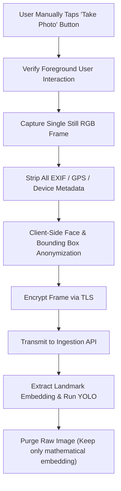

# IndoorAI — Privacy, Security & Ethics Framework

## 1. Ethical Stance and Anti-Surveillance Principles

Indoor localization technologies carry inherent privacy and human rights risks if improperly designed or deployed without rigorous governance. **IndoorAI is strictly an authorized, opt-in platform.**

### Non-Negotiable System Invariants:
1. **No Covert Tracking:** IndoorAI shall never be used for clandestine or covert tracking of individuals, employees, or non-participating citizens.
2. **Explicit User Consent:** A device can only participate when the user grants explicit, revocable consent via the mobile application interface.
3. **No Passive Eavesdropping on Unregistered Devices:** The system does not monitor ambient probe requests or sniff Wi-Fi packets from nearby uninvolved pedestrians or third-party devices.
4. **Transparent Delineation:** The platform strictly separates **empirical observations** (direct sensor readings) from **AI-generated spatial estimates**, ensuring users and administrators always know the confidence level and origin of location data.

---

## 2. Device Participation & Consent Protocol

### 2.1 Enrollment and Revocation
- **Voluntary Enrollment:** When installing the IndoorAI Android client, users are presented with a granular Permissions & Consent manifest detailing exactly what data is collected (Wi-Fi scans, IMU data, and manual photos) and the specific operational purpose (indoor navigation or authorized facility support).
- **One-Tap Revocation:** Users can pause localization or delete their active device registration instantly with a single toggle in the mobile app.
- **Auto-Expiration:** Guest sessions automatically expire and terminate after a configurable duration (default: 8 hours).

### 2.2 Device Identifier Protection & Pseudonymization
To prevent long-term persistent profiling:
- **No Raw Hardware Identifiers:** Raw MAC addresses, IMEI numbers, and Android hardware serials are never collected, transmitted, or stored.
- **Cryptographic Ephemeral Tokens:** The mobile client generates an ephemeral, salted hash:
  $$\text{DeviceToken} = \text{HMAC-SHA256}(\text{RandomDeviceSecret}, \text{DaySalt})$$
- **Rotated Daily:** Salts rotate every 24 hours, preventing correlation of historical tracking paths across multiple days.

---

## 3. Visual Privacy & Camera Safeguards

Photographs provide critical visual cues for resolving complex indoor topologies, but present significant privacy hazards regarding bystanders and personal spaces.

### 3.1 Strict Camera Constraints
- **Zero Background Camera Execution:** The camera subsystem is **never** initiated in a background service, worker thread, or without direct foreground user interaction. There is no automated or continuous scanning of surrounding rooms.
- **Local Metadata Stripping:** Prior to transmission, the Android client sanitizes image byte headers, stripping all EXIF tags, GPS tags, camera hardware metadata, and capture timestamps.
- **Automated Face & License Plate Blurring:** Lightweight on-device computer vision models detect and apply Gaussian blur to human faces, identity badges, and license plates before the image leaves the user's handset.
- **Raw Image Ephemerality:** Once the server computes the dense visual landmark embedding and detects architectural signs, the original raw photograph is scheduled for immediate deletion from disk, retaining only the privacy-preserving vector embedding.

---

## 4. Network Security & Cryptographic Communication

### 4.1 Transport Layer Security
- **Strict HTTPS / WSS:** All API endpoints and WebSocket channels mandate TLS 1.3 with modern cipher suites (`ECDHE-RSA-AES256-GCM-SHA384`). Plain HTTP and insecure WebSockets are rejected at the edge gateway.
- **Certificate Pinning:** The Android application pins the backend server's public key certificate, eliminating vulnerability to rogue corporate proxies or man-in-the-middle (MitM) attacks.

### 4.2 API Authentication & Request Integrity
- **JWT Bearer Tokens:** Authenticated devices receive short-lived JSON Web Tokens (expiration $\le 60\text{ minutes}$) signed with HMAC-SHA256 or RS256.
- **Payload Timestamping & Replay Attack Prevention:** Ingestion telemetry frames include microsecond epoch timestamps and nonces. Payloads with timestamps skewed greater than 15 seconds from server time are rejected.

---

## 5. Role-Based Access Control (RBAC) & Authorization

IndoorAI enforces four distinct operational roles with least-privilege access:

| Role | Permissions & Spatial Scope |
| :--- | :--- |
| **End User (Self-Navigator)** | View only their own real-time location and floorplan path; zero visibility into other users. |
| **Facility Manager** | View aggregated spatial density heatmaps and unmapped corridor alerts; no personal identity tracking. |
| **System Administrator** | Manage building blueprints, calibrate AP coordinates, inspect MLflow experiment logs. |
| **Emergency Responder** | Break-glass elevated access to pinpoint authorized personnel or devices during verified critical incidents. |

### 5.1 Emergency Response "Break-Glass" Authorization
During emergency operations (e.g., structural evacuation, fire department assistance):
- High-precision tracking can be elevated for devices that have explicitly enabled "Emergency Locator Assistance".
- Every emergency activation requires cryptographic multi-party authorization or an authenticated emergency dispatch API signature.
- An immutable audit trail logs who initiated emergency tracking, the incident identifier, and the precise timestamps.

---

## 6. Physical & Phenomenological Limitations of Wi-Fi Localization

To prevent false confidence in mission-critical environments, all stakeholders must understand the physical constraints of RF indoor localization:

1. **Multipath & Shadow Fading:** Radio frequency signals bounce off metal surfaces, glass partitions, and concrete pillars, causing constructive and destructive wave interference. An identical physical position may register differing RSSI values across consecutive seconds.
2. **Dynamic Obstacles & Human Attenuation:** The human body consists primarily of water, which strongly attenuates $2.4\text{ GHz}$ and $5\text{ GHz}$ radio waves (~$3\text{ dB}$ to $6\text{ dB}$ loss per body obstruction). The user's orientation (holding phone in front vs. pocket) changes the observed fingerprint.
3. **Hardware & Antenna Heterogeneity:** Antenna gain and chipsets vary widely across Android manufacturers (Samsung, Google Pixel, Xiaomi). An identical signal may register as $-58\text{ dBm}$ on one phone and $-72\text{ dBm}$ on another.
4. **Expected Metric Precision Bounds:**
   - Wi-Fi fingerprinting alone provides an average 2D positioning accuracy of **$3\text{ to }10\text{ meters}$**.
   - Wi-Fi alone cannot guarantee sub-meter precision.
   - Sub-meter precision requires the integration of high-frequency IMU dead-reckoning and visual landmark identification.
5. **No Wall Penetration Assumption:** Wi-Fi credentials or signal presence do not provide insight into room occupancy or internal device state.

