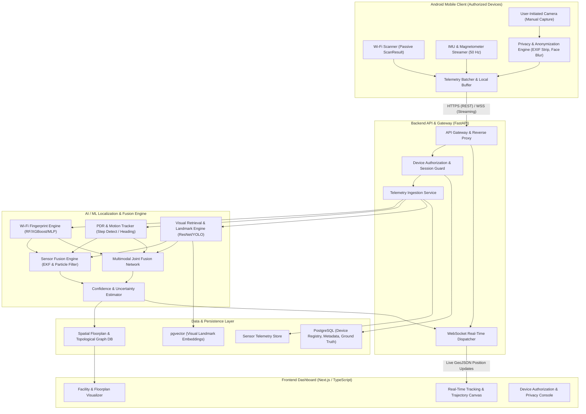
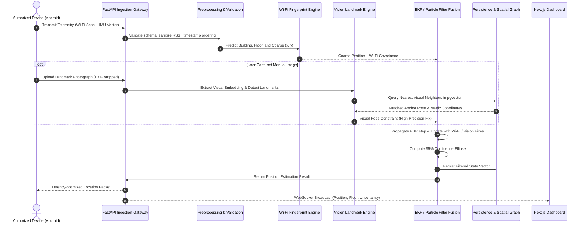

# IndoorAI — System Architecture

## 1. Architectural Overview

**IndoorAI** is a research-oriented, production-quality multimodal indoor localization and spatial mapping platform. Traditional GPS signals attenuate significantly inside reinforced concrete and steel structures, experiencing severe multipath degradation. IndoorAI overcomes this limitation by fusing three complementary sensing modalities collected from authorized participating mobile devices:

1. **Ambient Wi-Fi Signals:** Passive observation of nearby 802.11 access points (BSSID, RSSI, channel frequency, timestamps).
2. **Smartphone Inertial & Environmental Sensors:** High-frequency tri-axial accelerometer, gyroscope, and magnetometer readings.
3. **User-Initiated Visual Observations:** On-demand photographs of surrounding architectural landmarks (corridors, doors, signs, room numbers, structural boundaries).

The system integrates these heterogeneous streams through a layered, decoupled microservice and modular pipeline architecture designed for high throughput, sub-meter positioning potential, strict privacy enforcement, and progressive spatial map compilation.

---

## 2. Component Communication & Interactions

### 2.1 Android Client to Backend Communication
- **Passive Ingestion Stream:** High-frequency inertial measurements (accelerometer, gyroscope, magnetometer at 50 Hz) and periodic Wi-Fi scans (every 3 to 10 seconds, conforming to Android Wi-Fi scan throttling limits) are packaged in structured protocol buffers or JSON payloads.
- **Secure Transport:** Telemetry packets transmit over mutual TLS (HTTPS) or a secure WebSocket connection (`wss://`) authenticated via short-lived JWT tokens tied to an authorized device session.
- **Manual Image Ingestion:** Photograph uploads are sent via dedicated `multipart/form-data` endpoints. Images undergo local pre-check, EXIF sanitization, and immediate client-side face blurring before transmission.
- **Offline Tolerance:** When a mobile device traverses Wi-Fi dead zones, sensor readings are buffered in a local SQLite/Room database and synchronized with monotonically increasing timestamps when network connectivity recovers.

### 2.2 Backend to Machine Learning Pipeline
The backend acts as an orchestration and mediation layer:
1. **Payload Demultiplexing:** The FastAPI ingestion controller receives the combined telemetry frame, validates schema conformance using Pydantic, and routes sub-components to their respective processing modules.
2. **Synchronous Fast Path (Wi-Fi + PDR):** Wi-Fi RSSI vectors and PDR step estimates are processed in real time (< 50 ms latency budget) via compiled PyTorch/XGBoost inference pipelines and Kalman filtering.
3. **Asynchronous Deep Path (Visual Processing):** Uploaded photographs are queued for embedding extraction (ResNet/EfficientNet), landmark detection (YOLO), and vector similarity search against the facility landmark index.
4. **Fusion Aggregation:** The fusion coordinator reconciles the fast-path dead-reckoning trajectory with intermittent global localization fixes from Wi-Fi fingerprinting and visual landmark recognition.

### 2.3 Backend to Frontend Communication
- **Live Updates:** The backend broadcasts real-time estimated locations, uncertainty bounding ellipses, and floor transitions to connected web clients via WebSockets.
- **Restful Querying:** Map topology, structural walls, accessible paths, historical exploration trajectories, and model performance metrics are queried via standard REST APIs (`GET /api/v1/maps/{building_id}/{floor_id}`).

---

## 3. End-to-End Localization Workflow

---

## 4. How Spatial Mapping Works

IndoorAI employs a progressive **topological-metric hybrid mapping model**:

1. **Metric Coordinate Framework:**
   - Each indoor building $B$ has a predefined global coordinate origin $(x_0, y_0, z_0)$ tied to WGS84 coordinates (Latitude, Longitude) or local metric UTM coordinates.
   - Floors are discretized into indexed planar layers $z \in \{0, 1, 2, \dots, F-1\}$.
   - Positions inside a floor are represented as $(x, y)$ in meters relative to the floor's spatial origin.

2. **Topological Spatial Graph:**
   - Spaces (rooms, corridor segments, intersections, stairwells, elevators) are modeled as nodes $V$ in a spatial graph $G = (V, E)$.
   - Navigable corridors and doorways represent edges $E$ with associated metric distances and accessibility attributes.
   - Walkability masks and architectural boundary walls act as hard kinematic constraints preventing the particle filter from predicting paths through solid walls.

3. **Progressive Exploration & Crowdsourced Mapping:**
   - As authorized devices traverse uncharted corridors, the system aggregates Wi-Fi signal gradients, visual landmark detections, and step vectors.
   - Visual and topological loop closures (recognizing a previously seen door, sign, or distinct Wi-Fi profile) allow the system to optimize trajectory graphs using pose-graph optimization, progressively refining floorplans without requiring pre-existing blueprints.

---

## 5. Architectural Non-Functional Guarantees

| Metric / Dimension | Specification / Guarantee |
| :--- | :--- |
| **Inference Latency** | $\le 50\text{ ms}$ for Wi-Fi + PDR fast path; $\le 300\text{ ms}$ for visual retrieval |
| **Position Precision** | Floor classification $\ge 95\%$; 2D metric error $\le 3.5\text{ m}$ (Wi-Fi alone), $\le 1.5\text{ m}$ (Fused) |
| **Uncertainty Reporting** | Every estimate includes building probability, floor confidence, and a 2D covariance ellipse |
| **Decoupling** | ML inference runs as standalone callable pipelines with independent life cycles |
| **Zero Unauthorized Probing**| Devices must present cryptographically signed enrollment tokens before ingestion |
| **Auditability** | Complete separation between raw physical measurements and AI-estimated positions |

